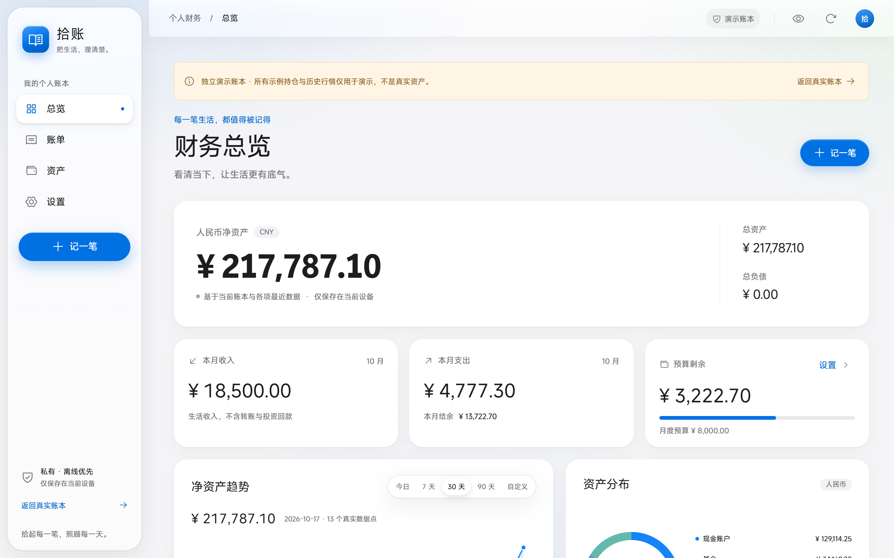
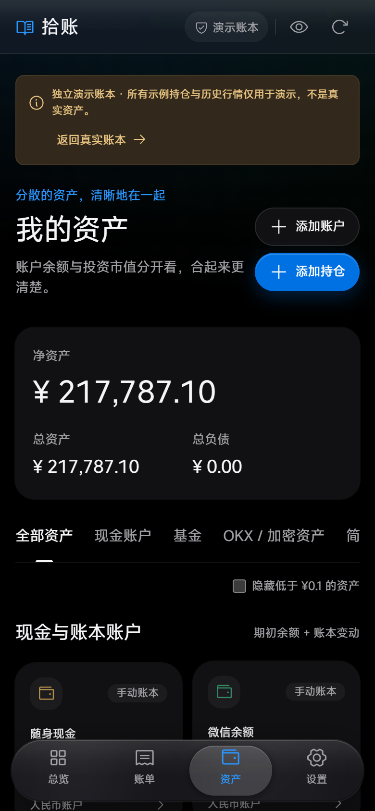

# 拾账 Gleanbook

**私有、离线优先的个人记账与资产管理网站。** 账本主库保存在你自己的电脑上，不依赖任何云服务；电脑浏览器与 iPhone 主屏幕 App 看到的是同一本账，离线也能记，连上后自动合并。

_A private, offline-first personal finance and portfolio tracker. Your ledger lives on your own computer; phone and desktop stay in sync over your private Tailscale network. Chinese UI._

> 本项目不构成任何投资建议。基金净值、行情与汇率来自公开接口，不保证准确、及时或长期可用；请以基金公司、交易所与银行的正式数据为准。

<p>
  
  
</p>

_截图均为内置演示账本的虚构数据。_

## 功能

- **日常记账**：收入、支出、转账、退款，账户支持 CNY / USD / HKD / EUR / USDT / USDC；跨币种转账显示实际汇率与溢价，可把溢价计为手续费；月度与分类预算。
- **投资与资产**：任意 6 位代码公募基金的正式净值（基金公司官网 → 东方财富 → 新浪，免费无需 Key）；OKX 现货行情；OKX **只读** API 读取资金 / 交易 / 简单赚币余额并人工核对后导入；移动加权平均成本、已实现与未实现收益。
- **自动汇率**：美元、欧元、港元取人民币中间价；USDT / USDC 按 OKX 实际价格折算，不假定等于 1 美元；手动汇率优先。
- **定投**：来源可为账户或持仓；定额或定份额；每天 / 工作日 / 每周 / 每两周 / 每月，执行时间精确到分钟；基金按交易日正式净值（15:00 截止），加密资产按该分钟价格；可选“节假日不扣款”（国务院放假通知）。
- **订阅**：每月 / 每年 / 每周固定扣费，到期自动从设定账户记支出，显示每月合计与临近扣款提醒。
- **总览**：净资产、月度收支、资产分布，净资产趋势（今日分时 / 7 / 30 / 90 天 / 自定义范围）。
- **多设备同步**：电脑主库 + 各设备离线副本，记录级合并（以后修改为准、删除优先、非法修改拒绝并说明原因），主库每日自动备份。
- **PWA**：可添加到 iPhone 主屏幕、离线使用；浅色 / 深色；Apple 风格排版与液态玻璃导航。
- **隐私**：无广告、无统计脚本、无第三方字体；OKX 密钥必须是只读权限，在 Windows 上用 DPAPI 加密保存，仅当前用户可解密。

## 快速开始（Windows）

需要 [Node.js 24](https://nodejs.org/) 或以上。

```powershell
git clone <仓库地址> gleanbook
cd gleanbook
npm ci
npm run build
npm start
```

浏览器打开 <http://localhost:8787>。`npm start` 不需要任何密钥：记账、基金净值、行情、定投、订阅都能用；可在侧栏“体验演示账本”查看示例数据。

### 连接 OKX 只读持仓与多设备同步

```powershell
npm run start:private
```

首次运行按提示输入 OKX **仅 Read 权限**的 API Key、Secret、Passphrase，以及你自己设置的网站访问口令（至少 32 字符）。验证通过后凭证加密保存，以后启动不再需要输入；`npm run forget:okx` 可清除。

- OKX 账号不在全球站：在 `.env` 设置 `OKX_API_ORIGIN`（美国 / 澳大利亚 `https://us.okx.com`，欧洲经济区 `https://eea.okx.com`）。
- 后端连不上 OKX（常见于需要代理的网络）：运行 `npm run diagnose:okx`，按提示在 `.env` 设置 `OKX_PROXY`，或开启代理软件的 TUN 模式。带密钥逐个检测接口：`npm run diagnose:okx:private`（只显示状态与耗时）。

### 在 iPhone 上使用

通过免费的 [Tailscale](https://tailscale.com/) 以 HTTPS 访问电脑，Safari“添加到主屏幕”即可离线使用并与电脑同步。完整步骤与开机自启动见 [docs/IPHONE.md](docs/IPHONE.md)。

## 配置（`.env`，可选）

复制 `.env.example` 为 `.env` 后按需填写：

| 变量                         | 作用                                                                      |
| ---------------------------- | ------------------------------------------------------------------------- |
| `GLEANBOOK_DATA_DIR`         | 电脑主库文件夹，默认 `用户目录/GleanbookData`                             |
| `OKX_API_ORIGIN`             | OKX 官方接口域名，按账号注册地区选择                                      |
| `OKX_PROXY`                  | 后端访问 OKX 使用的 HTTP 代理，如 `http://127.0.0.1:7890`；`off` 强制直连 |
| `GLEANBOOK_PUBLIC_ORIGIN`    | 手机访问用的 HTTPS 地址；留空时自动从 Tailscale 读取                      |
| `APP_ORIGIN`、`PORT`、`HOST` | 部署时的站点地址与监听设置，见 [docs/DEPLOYMENT.md](docs/DEPLOYMENT.md)   |

**不要把 `.env`、OKX 密钥或主库文件提交到仓库。**

## 文档

- [业务规则](docs/ACCOUNTING.md)：成本、收益、转账、定投、订阅、快照与同步规则
- [数据源与成本](docs/DATA-SOURCES.md)：各数据来源、刷新频率与费用
- [部署与安全](docs/DEPLOYMENT.md)
- [iPhone 与多设备同步](docs/IPHONE.md)

## 开发

```powershell
npm run dev        # Vite 开发服务器（另开终端 npm run server 提供 /api）
npm run check      # TypeScript 类型检查
npm test           # 单元测试（Vitest）
npm run test:e2e   # 浏览器测试（Playwright，默认使用本机 Chrome）
npm run format     # Prettier
```

```text
src/            React 前端：domain.ts（Decimal 记账规则与校验）、plans.ts（定投）、
                subscriptions.ts（订阅）、sync-core.ts（同步合并）、theme.css（视觉主题）
server/         Node 后端：同源静态服务、鉴权、OKX 只读、基金净值、汇率、节假日、电脑主库
scripts/        启动器、诊断、凭证加密保存、构建 Service Worker
tests/          单元测试与浏览器测试
```

欢迎贡献，请先阅读 [CONTRIBUTING.md](CONTRIBUTING.md)；安全问题请按 [SECURITY.md](SECURITY.md) 私下报告。

## 许可证

[GNU Affero General Public License v3.0 或更高版本](LICENSE)（AGPL-3.0-or-later）。

你可以自由使用、修改和分发本项目；若分发修改后的版本，或**通过网络向他人提供修改后的版本**，必须以相同许可证公开对应的完整源代码。

## 名称与旧版本兼容

英文名 **Gleanbook**（glean 意为“拾取”），中文名“拾账”。浏览器存储键名、JSON 备份与主库文件的格式标记等内部标识沿用 `shizhang`，因此“拾账”早期版本导出的 JSON 备份可以直接导入，对使用没有影响。
